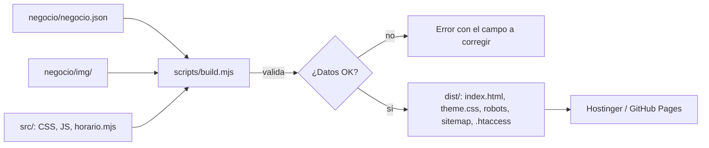

# 03 — Arquitectura

> Basado en: 01_PRD.md, 02_DESIGN_SYSTEM.md

## 1. Stack elegido
| Capa | Tecnología | Por qué |
|------|------------|---------|
| Frontend | HTML, CSS y JS (módulos ES) sin framework | Sitio de una página; carga rápida y nada que mantener |
| Generador | Script de Node (`scripts/build.mjs`) sin dependencias | HTML ya armado = mejor SEO que renderizar con JS; sin `npm install` no hay cadena de suministro que auditar |
| Backend | No aplica | Sitio estático |
| Base de datos | No aplica | Los datos viven en `negocio/negocio.json` |
| Autenticación | No aplica | No hay usuarios |
| Hosting | Hostinger (clientes) o GitHub Pages (demo) | Lo que ya uso |
| IA / LLM | No aplica | |

## 2. Diagrama de componentes


## 3. Estructura de carpetas
```
/
├── negocio/            ← lo único que cambia por cliente
│   ├── negocio.json
│   └── img/
├── src/
│   ├── styles.css
│   ├── app.js          ← cartel abierto/cerrado en el navegador
│   └── lib/
│       ├── horario.mjs ← lógica de horarios (navegador y Node)
│       ├── validar.mjs ← validación del JSON
│       ├── html.mjs    ← escape de HTML y JSON-LD
│       ├── color.mjs   ← contraste
│       └── render.mjs  ← arma el HTML
├── scripts/
│   ├── build.mjs
│   └── serve.mjs       ← servidor local para probar dist/
├── test/               ← node --test
├── docs/
└── dist/               ← generado, no se versiona
```

## 4. Flujo de datos
1. `build.mjs` lee el JSON y lo pasa por `validar.mjs`. Si hay errores, los lista y termina con código 1.
2. `render.mjs` arma el HTML escapando todo texto con `html.mjs`.
3. Se escriben `theme.css` (colores y fuentes), `favicon.svg` (inicial del negocio), `robots.txt`, `sitemap.xml` y `.htaccess`, y se copian `src/` e `img/`.
4. En el navegador, `app.js` lee los horarios de un `<script type="application/json">` y actualiza el cartel cada minuto con `horario.mjs`.

## 5. Integraciones externas
| Servicio | Para qué | Cómo |
|----------|----------|------|
| WhatsApp | Contacto | Links `https://wa.me/<número>?text=…` |
| Google Maps | Mapa y "Cómo llegar" | `<iframe>` de embed y link de direcciones |
| Google Fonts | Tipografías | `<link>` a fonts.googleapis.com |

## 6. Despliegue / hosting
- **Hostinger:** subir el contenido de `dist/` a `public_html`. El `.htaccess` generado fuerza HTTPS y agrega headers de seguridad.
- **GitHub Pages:** el workflow `.github/workflows/ci.yml` corre tests, arma el sitio y lo publica en cada push a `main`.
- No hay variables de entorno.

## 7. Decisiones y trade-offs
| Fecha | Decisión | Alternativas | Motivo |
|-------|----------|--------------|--------|
| 2026-10-08 | Build en Node que genera HTML | Página que carga el JSON con `fetch` | Con `fetch` el contenido no está en el HTML y Google lo indexa peor |
| 2026-10-08 | Cero dependencias | Eleventy, Astro | Un solo template no justifica un framework; nada que actualizar |
| 2026-10-08 | Colores en `theme.css` generado | `<style>` inline | Permite una CSP sin `unsafe-inline` |
| 2026-10-08 | Horario con `Intl` y zona del negocio | Hora del visitante | Un visitante de otro país vería el estado equivocado |
